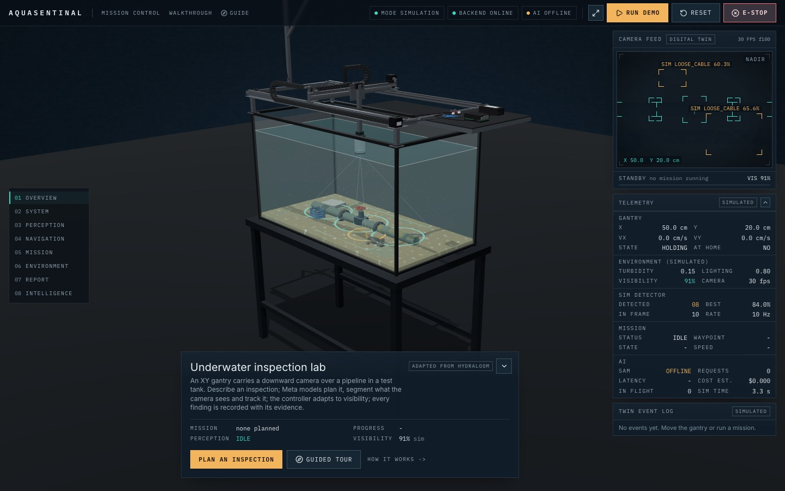
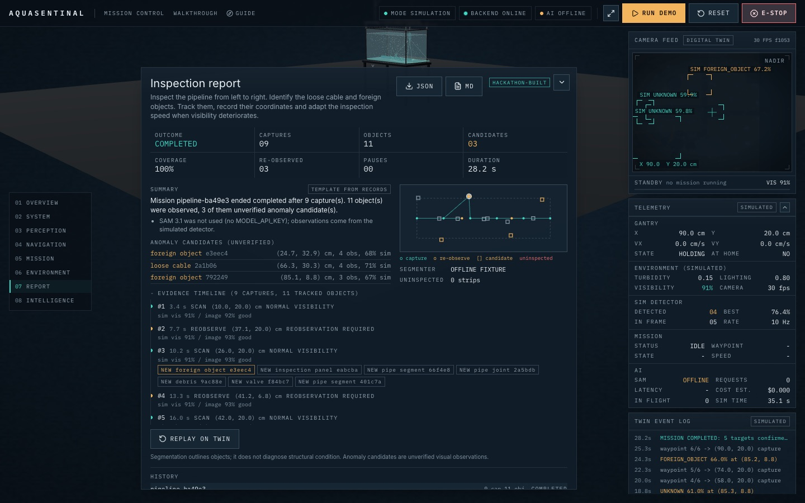
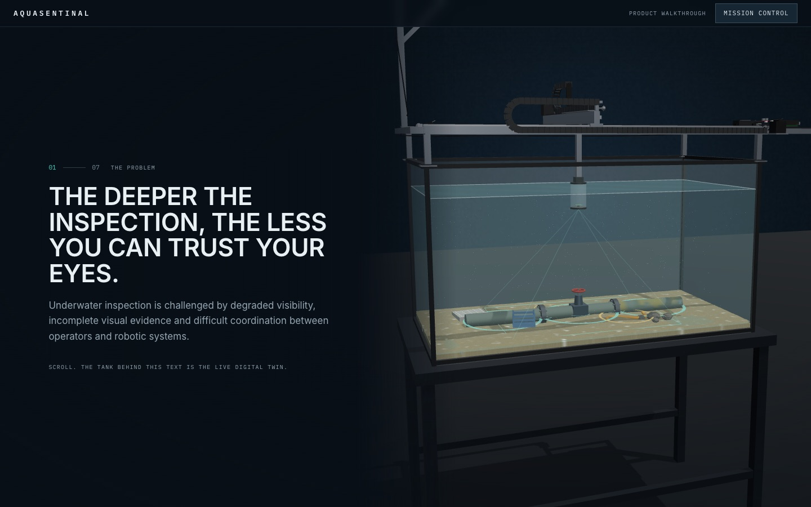

# AquaSentinal

**Talk to an underwater inspection rig and trust what it reports: Meta's Muse Spark, SAM 3.1 and Voice Transcribe plan, see and explain the job, and every output says where it came from.**

- Live app: https://aquasentinal-meta.vercel.app
- Backend: https://aquasentinal-backend.onrender.com (free tier, it sleeps when idle, so the first load can take a minute)

No Meta API key has been set yet, so the live deployment runs in labelled offline mode.
Nothing on screen is called live Meta output unless a live request was logged; there is no recorded live run to show yet.

### Judge path (three steps)

1. **Watch the demo video** (about two and a half minutes, attached to the submission).
   It was recorded offline against this app, so every panel says OFFLINE, and the video says so.
2. **Open the live app and run the demo.**
   Press `8` for Intelligence, check the Judge preflight, then press Start judge demo.
   A spoken or typed instruction becomes a plan, you approve it, the twin scans, SAM perception runs, the controller slows and pauses in murky water, and the report appears.
   In the Report scene (`7`), try Ask the inspector (click a citation and the twin moves to that capture) and Print work orders.
   The chip in the top bar is the credit meter; its popover shows the cache, budget cap and live lock.
3. **Try the real water camera.**
   Press the camera icon in the header and point a phone or laptop camera at water, or at anything.
   With the Meta key SAM 3.1 outlines what you name; without it the panel says "SAM 3.1 needs the Meta key" and still shows the frame.

| Mission control | Evidence report | Walkthrough |
|---|---|---|
|  |  |  |

Why it matters, with sources and the figures we could not source: [docs/IMPACT_AND_MARKET.md](docs/IMPACT_AND_MARKET.md).
Submission plan and likely judge questions: [docs/SUBMISSION_STRATEGY.md](docs/SUBMISSION_STRATEGY.md).

Multimodal AI underwater inspection on a camera gantry, built on the HydraLoom testbed (commit `d59308e`).

An operator describes an inspection by voice or text.
Muse Spark 1.3 turns it into a structured mission through allowlisted tools; the backend validates it and compiles bounded waypoints.
After the operator approves, a deterministic digital twin of the XY gantry scans a pipeline in a test tank, capturing a frame at each waypoint.
Each frame goes through OpenCV image-quality analysis, Muse Spark frame reasoning, SAM 3.1 segmentation and track association.
The scan slows in degraded visibility, pauses when the camera cannot be trusted, and re-observes uncertain detections.
Every finding is stored with its frame, source and uncertainty, and the report marks anomaly candidates as unverified.

## What is new here

AquaSentinal extends HydraLoom, an earlier bench-top gantry testbed by the same author; the 3D tank, gantry, camera rig and core motion and detection maths are inherited.
docs/HACKATHON_CONTRIBUTIONS.md lists exactly what was built for the hackathon and what was reused, and `docs/evidence/provenance.tsv` compares every file with the HydraLoom source.
Scene 08 (Intelligence) shows the new pipeline with the provenance of each step.

## Status

| Area | State |
|---|---|
| Digital twin, missions, adaptive policy, ten scenarios | Working and tested (`npm run sim:check`) |
| Backend API, persistence, reports, event sockets | Working and tested (143 pytest tests) |
| Muse Spark, SAM 3.1, Voice Transcribe | Implemented to the documented API, tested with mocked HTTP only: no API key was available, so no live request has been made (docs/META_USAGE_EVIDENCE.md) |
| Credit governor: response cache, cascade gating, USD budget cap, passcode live lock; credit meter chip | Working and tested with mocked HTTP; the cap and lock are enforced before any request leaves |
| Hindi and English voice and AI output, Ask the Inspector (grounded Q&A that cites captures), work orders with print layout | Working and tested; live paths tested with mocked HTTP, offline paths are labelled rule-based answers |
| Real water camera (header camera icon): one phone or laptop frame to SAM 3.1 | Working and tested with a fake device and mocked answers; without the Meta key it says "SAM 3.1 needs the Meta key" |
| Not built yet | Murk benchmark, live-run recorder, /proof page and recorded replay: they need a live key to have anything to show |
| Model execution log, judge preflight, judge demo | Working and tested; every Meta request is logged as LIVE_META, LIVE_META_FAILED or MOCKED |
| Evaluation | Fixed versus adaptive and offline parsing measured; live Spark, Voice and SAM sections need a key (docs/TECHNICAL_EVALUATION.md) |
| Offline mode (no key) | Working; labelled keyword parser, simulated detector, twin-geometry outlines, template summary |
| Gantry hardware | GRBL 1.1 serial driver, interlocks and watchdog implemented and tested against a fake controller; never run on physical hardware; disabled by default |

## Run it

Requirements: Node.js 20 or later, Python 3.11 or later.

```bash
npm install
python3 -m venv backend/.venv
backend/.venv/bin/pip install -r backend/requirements-dev.txt
export MODEL_API_KEY=...       # optional: enables the Meta models; leave unset for labelled offline mode
npm run dev:all                # frontend http://localhost:3000, backend http://localhost:8000
```

To run the two halves separately:

```bash
npm run dev
npm run backend:dev            # creates backend/.venv on first run, reinstalls only when requirements change, auto-reloads
npm run backend:dev -- --fresh # same, starting from an empty local database (backend/data)
```

`npm run backend:dev -- --help` lists the options (`--port`, `--fresh`, `--no-reload`).
Local settings such as `MODEL_API_KEY` can go in `backend/.env.local` (gitignored, same keys as `.env.example`); variables set in the shell take precedence.

The backend reads its configuration from the process environment only; no `.env` file is loaded.
Export the variables listed in `.env.example` in the shell that starts the backend, or prefix the command, for example `MODEL_API_KEY=... npm run dev:all`.
Without `MODEL_API_KEY` everything runs in labelled offline mode.

## Deploy it

Live: https://aquasentinal-meta.vercel.app (backend https://aquasentinal-backend.onrender.com; it sleeps when idle, so give it a minute to wake).

Free hosting: frontend on Vercel, backend on Render (Docker, WebSockets). `render.yaml` and `vercel.json` hold the configuration; [docs/DEPLOYMENT.md](docs/DEPLOYMENT.md) has the steps, the environment variables (`NEXT_PUBLIC_BACKEND_URL` on Vercel; `CORS_ORIGINS`, optional `CORS_ORIGIN_REGEX` and `MODEL_API_KEY` on Render) and what the free tier means for a demo.

## Explore it

- http://localhost:3000/walkthrough is a scroll-driven explanation of the product over the live twin: the problem, the rig, the model pipeline, perception, adaptive control and a measured result.
- In mission control, Guide in the header (or Guided tour on the Overview card) starts a nine-step tour of the controls; F collapses the panels to give the 3D view the screen.

## Judge demo

```bash
export MODEL_API_KEY=...       # without it every model step is labelled OFFLINE FALLBACK or NOT RUN
npm run dev:all
```

Open http://localhost:3000, press `8`, check the Judge preflight, then press Start judge demo.
docs/FINAL_DEMO_SCRIPT.md is the script and docs/DEMO_VALIDATION_CHECKLIST.md the checklist.

## Evaluate it

```bash
npm run eval:adaptive          # fixed versus adaptive on all ten presets, with a replay check (simulated)
npm run eval:meta              # parsing accuracy; with MODEL_API_KEY also Voice, Spark and SAM IoU (live)
scripts/provenance.sh          # per-file comparison with the HydraLoom source commit
```

## Check it

```bash
npm run typecheck
npm run lint
npm run build
npm run sim:check
npm run e2e
cd backend && .venv/bin/python -m pytest
```

## Layout

```
app/                 Next.js routes (mission control, walkthrough) and design tokens
components/walkthrough/  Scroll-driven product walkthrough
lib/animations/      GSAP registration, context-scoped hook and motion tokens
components/lab/      Three.js twin: tank, gantry, pipeline objects, overlays, feed and capture renderer
components/ui/       Mission control, perception, navigation, environment, report, telemetry
lib/sim/             Deterministic engine: gantry, detector, missions, perception policy, scenarios, demo
lib/api/, lib/store/ Backend client, event socket, mission store
lib/hackathon/       Contribution registry behind the provenance badges
backend/app/         FastAPI: Meta clients, mission compiler and tools, perception pipeline, hardware, SQLite, reports
shared/              Geometry and perception config read by both languages, contract fixtures
docs/                Audit, migration map, architecture, integration, safety, testing, demo, roadmap
```

## Documents

- [Engineering audit](docs/ENGINEERING_AUDIT.md)
- [Migration map](docs/MIGRATION_MAP.md)
- [Architecture](docs/ARCHITECTURE.md)
- [Meta model integration](docs/META_MODEL_INTEGRATION.md)
- [Perception pipeline](docs/PERCEPTION_PIPELINE.md)
- [Hardware integration](docs/HARDWARE_INTEGRATION.md)
- [Safety](docs/SAFETY.md)
- [Testing](docs/TESTING.md)
- [Hackathon contributions and provenance](docs/HACKATHON_CONTRIBUTIONS.md)
- [Contribution audit](docs/CONTRIBUTION_AUDIT.md)
- [Meta usage evidence](docs/META_USAGE_EVIDENCE.md)
- [Technical evaluation](docs/TECHNICAL_EVALUATION.md)
- [Impact and market](docs/IMPACT_AND_MARKET.md)
- [Judging readiness](docs/JUDGING_READINESS.md)
- [Final demo script](docs/FINAL_DEMO_SCRIPT.md), [shot list](docs/DEMO_SHOT_LIST.md), [validation checklist](docs/DEMO_VALIDATION_CHECKLIST.md)
- [Deployment](docs/DEPLOYMENT.md)
- [Final product audit](docs/FINAL_PRODUCT_AUDIT.md) and [UI bug audit](docs/UI_BUG_AUDIT.md)
- [Roadmap](docs/ROADMAP.md)
